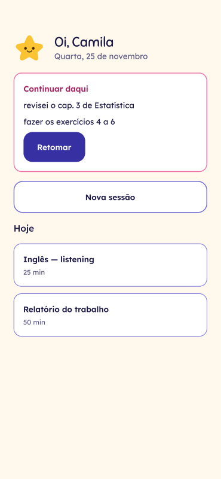
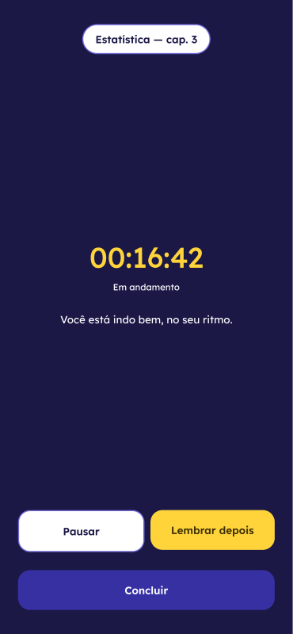
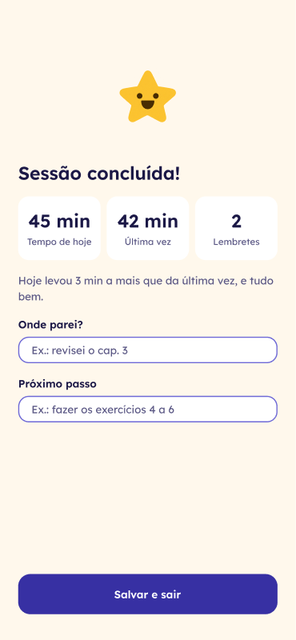

# ✦ Lume — App de Sessão de Foco

| Acesso | Link |
|---|---|
| 🎨 Protótipo no Figma | [Lume — UX/UI](https://www.figma.com/design/z7C1XSWQhlIpYry549Ba3Q) |
| ▶️ Protótipo navegável (link público) | [Abrir protótipo](https://www.figma.com/proto/z7C1XSWQhlIpYry549Ba3Q/Lume-%E2%80%94-UX-UI?node-id=43-3&p=f&viewport=217%2C273%2C0.21&t=U2qWueE7FQUYMI9P-1&scaling=min-zoom&content-scaling=fixed&starting-point-node-id=43%3A3&page-id=2%3A3) |
| 🎬 Vídeo pitch | *(a publicar na F7)* |
| 📄 Documento teórico | [docs/01-teorico.md](docs/01-teorico.md) |
| 🐙 Repositório | [github.com/tpalomaai/UNIFECAF-ux-ui-lume-focus-app](https://github.com/tpalomaai/UNIFECAF-ux-ui-lume-focus-app) |

> Projeto acadêmico — UniFECAF · Design de Interação e Interface UX/UI ("Da Ideia à Experiência: Projetando e Prototipando uma Interface Digital com Figma")

## Objetivo do produto
**Lume** é um app mobile de sessão de foco **sem pressão**. Em vez de contagem regressiva — que gera ansiedade e sensação de fracasso quando o tempo acaba —, um cronômetro **progressivo** mede quanto tempo cada tarefa leva. Com o histórico, a pessoa acompanha a própria evolução e melhora no seu ritmo, sem competir contra o relógio.

Pensado para quem estuda ou trabalha **sozinho e de forma remota** (universitários EAD, profissionais em home office, estudantes de idiomas), o app resolve um problema recorrente desse público: depois de qualquer distração, leva de 30 minutos a 1 hora só para lembrar onde parou. O Lume guarda **onde a pessoa parou e qual é o próximo passo**, para que retomar leve segundos.

Detalhes completos do problema, usuária e pesquisa em [docs/01-teorico.md § 1.1](docs/01-teorico.md#11-problema-e-usuário).

## Fluxo principal
```
01 Boas-vindas → 02 Início → 03 Escolher tarefa → 04 Sessão em andamento ⇄ 05 Lembrar depois → 06 Sessão concluída → 02 Início
```
- **Atalho:** no Início, o botão **Retomar** pula direto para a sessão da última tarefa.
- **Pausa:** "Pausar"/"Continuar" trocam a tela 04 (Rodando) e 04b (Pausado) no lugar, sem navegar pra outro contexto.
- **Desvio sem perder o lugar:** "Lembrar depois" anota uma tarefa paralela em 1 toque e volta exatamente pra sessão em andamento.
- A sessão só termina quando a pessoa toca em **Concluir** — nunca por um prazo que acaba.

Jornada completa (7 etapas, sentimentos e oportunidades de design) em [docs/01-teorico.md § 1.2](docs/01-teorico.md#12-jornada-do-usuário).

| Início | Sessão em andamento | Sessão concluída |
|---|---|---|
|  |  |  |

## Decisões de design
- **Cronômetro progressivo, nunca regressivo** — sem prazo, não existe "falhar"; elimina a principal fonte de ansiedade encontrada na pesquisa com usuárias de apps como Forest e Pomodoro Timer.
- **Paleta "céu de estrelas"** com função fixa por cor: índigo é sempre a ação principal, estrela (amarelo) é sempre progresso/conquista, rosa é só o atalho "Continuar daqui", vermelho é reservado exclusivamente pro estado de erro.
- **Lexend** como fonte de todo texto funcional — escolhida por reduzir o esforço de leitura; **Sniglet** só na saudação, pra dar personalidade sem prejudicar a leitura.
- **Design system único**: todo componente (botão, card, input, cronômetro) é reutilizável com variantes, ligado só a tokens — uma correção na Library (ex.: contraste de uma cor) atualiza as 7 telas de uma vez.
- **Linguagem sempre gentil**: nenhuma tela usa palavras como "falhou", "atrasou" ou "erro" voltadas à usuária — até o pior cenário é tratado como "e tudo bem".
- **Acessibilidade desde o design**: contraste AA calculado e corrigido via WCAG, toque mínimo de 48px em todo elemento clicável, nada depende só de cor, rótulos sempre visíveis.

Tabela completa de decisões de UI e acessibilidade em [docs/01-teorico.md § 1.4–1.5](docs/01-teorico.md#14-decisões-de-interface-ui); design system completo (cores, tipografia, componentes) em [docs/03-design-system.md](docs/03-design-system.md).

## Autora
Paloma Ai Tsuchinaga — [GitHub](https://github.com/tpalomaai)
