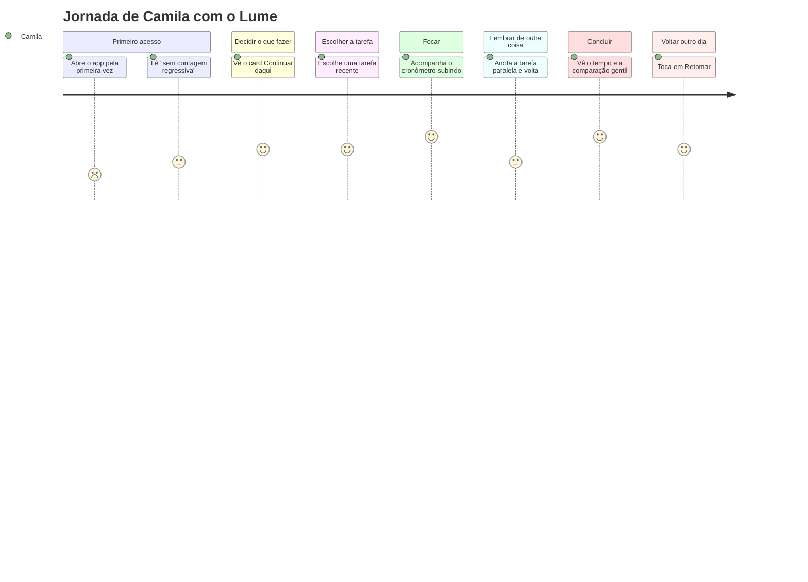
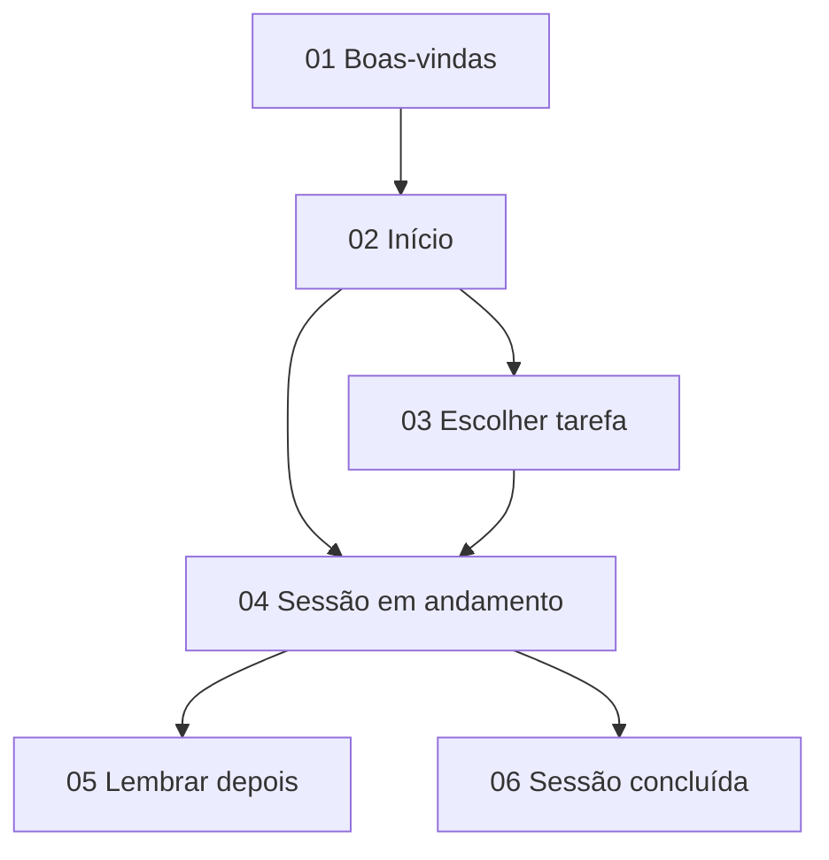

# Documento Teórico — Lume

> Status: **Completo** — seções 1.1 a 1.5 escritas (1.1–1.3 na F1, 1.4–1.5 na F5).

---

## 1.1 Problema e Usuário

### Qual problema o produto resolve?
Pessoas que estudam ou trabalham **sozinhas e de forma remota** não têm uma estrutura externa que as ajude a manter o foco: não há professor, colega ou horário fixo que "puxe" a atenção de volta. Isso gera um ciclo conhecido: outras tarefas competem pela atenção no meio do trabalho e, depois de uma pausa, a pessoa perde **de 30 minutos a 1 hora** só para lembrar onde estava e o que precisava fazer em seguida.

Os apps de foco mais conhecidos (como Forest e timers de Pomodoro) usam **contagem regressiva**: a pessoa precisa terminar algo antes do tempo acabar. Para muitos usuários, isso vira uma competição contra o relógio que gera **ansiedade e sensação de fracasso** quando a tarefa não termina a tempo. O resultado é baixa adesão e **abandono nas primeiras interações**, exatamente o problema descrito pela startup.

O **Lume** inverte essa lógica: em vez de cobrar, ele **mede**. Um cronômetro progressivo registra quanto tempo a tarefa levou, sem prazo nem alarme. Com o histórico de cada tarefa, a pessoa percebe a própria evolução e melhora naturalmente. Além disso, o app guarda **onde ela parou e qual é o próximo passo**, para que a retomada leve segundos, e não uma hora.

#### Problem Statement
> **Universitários EAD, profissionais em home office e estudantes de idiomas** que estudam ou trabalham sozinhos, com tempo fragmentado, **precisam de uma forma de manter o foco e retomar o trabalho em segundos, sem a pressão de um prazo**, **para** concluir as tarefas no próprio ritmo em vez de abandonar o app nas primeiras tentativas.

*(Modelo: [usuário] precisa de [necessidade] para [objetivo] — a declaração fala do problema, não da solução.)*

### Quem é o usuário?
Adultos que **aprendem ou trabalham por conta própria, em casa**, com tempo fragmentado e várias tarefas em paralelo:

| Perfil | Contexto |
|---|---|
| Universitários EAD | Assistem aulas e fazem atividades sozinhos, muitas vezes à noite, depois do trabalho |
| Profissionais em home office | Alternam tarefas, reuniões e demandas da casa sem a estrutura do escritório |
| Estudantes de idiomas | Repetem os mesmos tipos de tarefa (lição, flashcards, leitura) e querem ver evolução |

#### Persona principal
**Camila, 29 anos**, cursa graduação EAD e trabalha em home office. Estuda inglês no tempo livre.
- **Rotina:** muitas tarefas acontecendo ao mesmo tempo; estuda quando consegue definir um objetivo claro.
- **Ferramentas:** celular sempre por perto, notebook para trabalho e faculdade.
- **Frase:** *"Não quero correr contra o relógio. Quero saber quanto tempo levei e ir melhorando no meu ritmo."*
- **Objetivo:** concluir o que começou, do início ao fim, e entender quanto tempo cada tipo de tarefa realmente leva.
- **Frustração:** já usou Forest e Pomodoro Timer, mas a contagem regressiva a deixava ansiosa e com a sensação de ter falhado quando não terminava a tempo.

### Quais dores e necessidades existem?
| Dores | Necessidades |
|---|---|
| **Tarefas em paralelo:** outras coisas para fazer competem pela atenção no meio da sessão | **Tirar a outra tarefa da cabeça** sem largar a atual, com a certeza de que não será esquecida |
| **Pressão do relógio:** a contagem regressiva gera ansiedade e sensação de fracasso | **Medir o tempo sem cobrança**: registrar quanto levou, sem prazo nem alarme |
| **Retomada lenta:** de 30 min a 1 h para lembrar onde parou e o que fazer depois | **Retomar em segundos**, com "onde parei" e "próximo passo" registrados |
| **Falta de referência:** não sabe se está ficando mais rápida em tarefas repetidas | **Ver o histórico da mesma tarefa** e comparar com a vez anterior, de forma gentil |

> ✅ **Pesquisa com usuária (entrevista em profundidade com a autora, que faz parte do público-alvo):**
> - Maior distração: ter outras coisas para fazer em paralelo.
> - Já usou Forest e Pomodoro Timer; a lógica de competir com o tempo gera ansiedade.
> - O que funciona: medir o tempo gasto e otimizar naturalmente, sem prazo.
> - Retomar após pausa leva de 30 min a 1 h; o problema é lembrar onde estava e o que vem depois.
> - Uso: ao definir um objetivo para cumprir do começo ao fim, registrando o tempo para comparar na próxima vez.

### Como estruturamos esse entendimento

#### Matriz CSD (Certezas, Suposições e Dúvidas)
| ✅ Certezas | 🤔 Suposições | ❓ Dúvidas |
|---|---|---|
| A maior distração de Camila é ter outras tarefas em paralelo (entrevista) | Outros universitários EAD e profissionais em home office sentem a mesma ansiedade com contagem regressiva | Pessoas fora do perfil de Camila (ex.: quem não estuda, só trabalha remoto) sentem essa dor com a mesma intensidade? |
| A contagem regressiva gera ansiedade e sensação de fracasso nela (entrevista) | "Lembrar depois" é suficiente pra resolver a distração de tarefas paralelas, pra qualquer usuário | As pessoas vão querer só anotar, ou vão querer voltar de fato pra tarefa paralela? |
| Retomar após uma pausa leva de 30 min a 1 h pra ela (entrevista) | Ver o histórico de tempo motiva a pessoa a continuar usando o app | Qual o tamanho real do público que já abandonou um app de foco por causa da contagem regressiva? |
| Medir o tempo sem prazo é o que funciona pra ela (entrevista) | O cronômetro progressivo por si só já reduz a ansiedade, sem precisar de outros recursos | — |

> [!note] Transparência sobre o método
> Esta pesquisa usou uma **entrevista em profundidade com uma única pessoa** (a autora, que faz parte do público-alvo) — um método qualitativo válido para gerar hipóteses (Jakob Nielsen defende que poucos participantes já revelam os problemas principais em testes de usabilidade), mas as colunas de **Suposições** e **Dúvidas** acima deixam explícito onde um projeto real ainda precisaria validar com mais usuários antes de decidir com total confiança.

#### Mapa de Empatia — Camila
| Quadrante | O que foi levantado |
|---|---|
| 💭 **Pensa e sente** | "Será que vou dar conta de trabalhar e estudar?"; medo de começar algo e não terminar |
| 👀 **Vê** | Colegas de EAD desistindo no meio do curso; apps de produtividade com temporizadores agressivos |
| 👂 **Ouve** | Amigos recomendando técnica Pomodoro; conteúdos de produtividade vendendo "disciplina" e "foco absoluto" |
| 🗣️ **Fala e faz** | Diz "hoje eu me organizo", mas troca de tarefa toda vez que surge uma distração nova |
| 😣 **Dores** | Tarefas em paralelo competindo pela atenção; pressão do relógio; retomada lenta; falta de referência de evolução |
| 🌟 **Ganhos** | Terminar o que começou; saber quanto tempo cada tarefa realmente leva; sentir que está melhorando, não competindo |

---

## 1.2 Jornada do Usuário

### Fluxo principal
Boas-vindas → Início → Escolher tarefa → Sessão em andamento ⇄ Lembrar depois → Sessão concluída → Início
*(Atalho: no Início, "Retomar" leva direto à sessão da última tarefa.)*

### Etapas e objetivos em cada interação
| Etapa | Objetivo da usuária | Ação no app | Tela | Sentimento | Oportunidade de design |
|---|---|---|---|---|---|
| 1. Primeiro acesso | Entender que o app não é mais um timer de pressão | Lê "Foque no seu ritmo, sem contagem regressiva" e toca em "Começar" | 01 - Boas-vindas | Desconfiada (já desistiu de outros) 😐 | Deixar claro o "sem pressão" logo na primeira frase |
| 2. Decidir o que fazer | Lembrar onde parou | Lê o card "Continuar daqui" (onde parei + próximo passo) | 02 - Início | Aliviada 🙂 | Retomada em 1 toque: botão "Retomar" |
| 3. Escolher a tarefa | Definir o objetivo da sessão | Escreve uma tarefa nova ou escolhe uma recente (com o último tempo) | 03 - Escolher tarefa | Decidida 🙂 | Tarefas recentes evitam redigitar e criam histórico |
| 4. Focar | Trabalhar no próprio ritmo | Acompanha o cronômetro subindo; pode pausar | 04 - Sessão em andamento | Tranquila 😌 | Cronômetro progressivo, sem alarme nem cor de alerta |
| 5. Lembrar de outra coisa | Não esquecer a tarefa paralela sem largar a atual | Toca em "Lembrar depois", anota e volta | 05 - Lembrar depois | Preocupada → aliviada 😟→🙂 | A tarefa paralela fica guardada, sem culpa |
| 6. Concluir | Ver quanto levou e registrar onde parou | Toca em "Concluir", vê o tempo e a comparação com a última vez, e preenche "Onde parei" e "Próximo passo" | 06 - Sessão concluída | Orgulhosa 😄 | Comparação gentil: celebra quando melhora e acolhe quando não melhora |
| 7. Voltar outro dia | Retomar sem esforço | Abre o app e toca em "Retomar" | 02 - Início | Confiante 🙂 | O ciclo recomeça com contexto, não do zero |

### Journey Map (curva de emoção)
> Não existe uma versão "estado atual" do Lume (é um produto novo, não um redesign) — o mapa abaixo já representa o **estado futuro**: a jornada completa *com* a solução.

O ponto mais baixo da curva é o **primeiro acesso** (desconfiança natural de quem já abandonou outros apps) — por isso a tela 01 investe a primeira frase inteira em deixar claro o "sem pressão", antes de qualquer outra informação.

### Pain Points (priorização por impacto × frequência)
| Dor | Tipo | Impacto | Frequência | Prioridade |
|---|---|---|---|---|
| Pressão do relógio (contagem regressiva) | Emocional | Alto | Alta | 🔴 Prioridade máxima |
| Retomada lenta (30 min a 1 h) | De produtividade | Alto | Alta | 🔴 Prioridade máxima |
| Tarefas em paralelo competindo pela atenção | Emocional / de processo | Alto | Média | 🔴 Prioridade máxima |
| Falta de referência de evolução | De processo | Médio | Média | 🟡 Melhoria importante |

### Como poderíamos...? (de cada dor para uma decisão de design)
| Pergunta "Como poderíamos...?" | Decisão de design que respondeu |
|---|---|
| ...medir o tempo de uma tarefa sem fazer a pessoa se sentir cobrada? | Cronômetro **progressivo**, sem alarme nem cor de alerta |
| ...fazer a retomada levar segundos em vez de até 1 hora? | Card **"Continuar daqui"** + botão **Retomar** como ação primária do Início |
| ...tirar uma tarefa paralela da cabeça sem a pessoa perder o contexto da sessão atual? | **"Lembrar depois"**: anotação de 1 toque que sempre volta pra mesma sessão |
| ...mostrar a evolução da pessoa sem parecer uma cobrança? | **Comparação gentil** ao concluir ("3 min a menos que da última vez" / "levou mais tempo hoje, e tudo bem") |

---

## 1.3 Estrutura da Solução (UX)

### Organização das telas
O app tem **6 telas** e um único fluxo principal, organizado em três momentos:

| Momento | Telas | Papel |
|---|---|---|
| **Antes do foco** | 01 Boas-vindas · 02 Início · 03 Escolher tarefa | Começar ou retomar rápido, com contexto |
| **Durante o foco** | 04 Sessão em andamento · 05 Lembrar depois | Manter a atenção e guardar tarefas paralelas |
| **Depois do foco** | 06 Sessão concluída | Ver a evolução e preparar a próxima vez |

### Lógica de navegação
- **Linear e previsível:** cada tela tem **uma ação principal**, que leva à próxima etapa.
- **Um atalho:** no Início, "Retomar" pula a escolha da tarefa e abre a sessão da última tarefa.
- **Um único desvio:** na Sessão, "Lembrar depois" abre uma anotação rápida que sempre volta para a mesma sessão, com o cronômetro pausado e preservado.
- **Fim controlado pela usuária:** a sessão termina quando ela toca em "Concluir", não quando um tempo acaba.
- **Ciclo fechado:** a tela Sessão concluída sempre leva ao Início, onde aparecem "onde parei" e "próximo passo".
- **Sem menus escondidos:** nenhuma aba, menu lateral ou configuração obrigatória no fluxo principal.

### Decisões tomadas para facilitar o uso
| Decisão | Princípio | Como aparece no Lume |
|---|---|---|
| Cronômetro progressivo em vez de contagem regressiva | **Design emocional / redução de ansiedade:** sem prazo, não existe "falhar" | O tempo sobe a partir de 00:00; sem alarme e sem cor de alerta |
| "Continuar daqui" com 2 campos | **Efeito Zeigarnik:** tarefas inacabadas ocupam a mente; registrá-las libera atenção e acelera a retomada | "Onde parei" + "Próximo passo", mostrados no Início |
| Botão "Retomar" no Início | **Lei de Fitts e redução de passos:** a ação mais frequente fica grande, próxima e a um toque | Retomada em 1 toque, em vez de 30 min a 1 h |
| "Lembrar depois" | **Carga cognitiva:** tirar a tarefa paralela da cabeça libera memória de trabalho | Anotação rápida durante a sessão, guardada em uma lista |
| Tarefas recentes com o último tempo | **Lei de Hick:** escolher em uma lista curta é mais rápido do que criar do zero | Até 3 tarefas recentes, cada uma com "última vez: 42 min" |
| Comparação gentil com a última vez | **Regra do pico-fim:** o final da experiência define como ela é lembrada | "3 min a menos que da última vez ✦" ou "Levou mais tempo hoje, e tudo bem" |
| Cronômetro e botões conhecidos (Pausar/Play) | **Lei de Jakob:** usuários preferem padrões que já conhecem | Nada a aprender: funciona como o cronômetro do celular |

### Processo de design usado
O projeto seguiu a lógica do **Duplo Diamante** (Design Council), equivalente às 5 etapas do Design Thinking (Empatizar/Definir/Idear/Prototipar/Testar):

| Diamante | Fase | O que fizemos | Ferramentas / entregáveis |
|---|---|---|---|
| 1º — Descobrir | F0–F1 (início) | Entrevista em profundidade (autoetnografia) e desk research informal sobre apps concorrentes (Forest, Pomodoro) | Entrevista, comparação informal com concorrentes |
| 1º — Definir | F1 | Organizar os achados num problema único e numa persona | Matriz CSD, Mapa de Empatia, **Problem Statement**, Persona, Pain Points |
| 2º — Desenvolver | F1–F2 | Gerar e escolher as funcionalidades; desenhar a navegação e as telas em baixa fidelidade | Perguntas **HMW**, Matriz de Impacto × Esforço, User Flow, Wireframes (F2) |
| 2º — Entregar | F3–F6 | Construir o design system, montar as telas finais, ligar o protótipo, testar e documentar | Library (F3), Protótipo navegável (F4), auditoria de acessibilidade (F5), este documento |

### Arquitetura da Informação
- **Sistema de organização:** hierárquico e **linear** — decisão deliberada. O Lume resolve **uma tarefa por vez** (focar), não uma coleção de conteúdos que precisaria de categorias e menu; por isso não existe uma aba ou menu lateral com várias seções.
- **Sistema de rotulagem:** os nomes vêm da fala da própria usuária entrevistada — "Continuar daqui", "Lembrar depois" — em vez de termos técnicos como "sessão pendente" ou "anotação rápida".
- **Sistema de navegação:** sem navegação global (abas/menu); cada tela tem **uma única ação principal** (Princípio da Navegação Focada, Dan Brown). O card "Continuar daqui" funciona como **porta de entrada** fixa no Início, sempre visível e sempre levando direto ao ponto onde a pessoa parou (Princípio das Portas de Entrada).
- **Mapa do site (sitemap):** estrutura **larga e rasa** de propósito — poucas telas, sem profundidade de menus, porque cada clique extra custa caro para quem já tem pouco tempo (ver [[Hierarquia Taxonômica]] nos resumos da disciplina).

### User Flow
O fluxo completo, com o caminho feliz **e** o ponto de decisão real do produto, está em [docs/02-fluxo.md](02-fluxo.md). A decisão "☐ Tem uma sessão anterior salva?" no Início é o que diferencia este diagrama de um simples *Task Flow* linear: ela define se a usuária vê o card "Continuar daqui" preenchido (Estado = Com conteúdo) ou vazio (Estado = Vazio) — ambos construídos como variantes do mesmo componente na Library (F3).

### Matriz de Impacto × Esforço (priorização de funcionalidades)
| Ideia | Impacto | Esforço | Quadrante | Decisão |
|---|---|---|---|---|
| Cronômetro progressivo (sem contagem regressiva) | Alto | Baixo | ⚡ Ganho rápido | ✅ Entrou — resolve a dor de maior impacto |
| "Continuar daqui" (onde parei + próximo passo + Retomar) | Alto | Médio | 🎯 Grande aposta | ✅ Entrou — retomada era a dor mais citada na pesquisa |
| "Lembrar depois" | Alto | Baixo | ⚡ Ganho rápido | ✅ Entrou |
| Comparação gentil com a última vez | Médio | Baixo | 🧩 Tarefa menor | ✅ Entrou |
| Animação do mascote ao concluir a sessão | Baixo (por ora) | Médio | 🧩 Tarefa menor | ⏸️ Estacionada para depois da entrega |
| Modo escuro completo (além da tela de foco) | Baixo (fora do modo foco) | Alto | 🚫 Evitar por ora | ⏸️ Estacionada para depois da entrega |

> As duas ideias estacionadas estão registradas em 🅿️ Estacionamento de ideias do `PROJECT_OVERVIEW.md` — não foram descartadas, só adiadas por terem esforço desproporcional ao impacto nesta entrega.

---

## 1.4 Decisões de Interface (UI)

### Cores e a função de cada token
O Lume usa uma paleta "céu de estrelas": cada cor tem **uma função fixa**, nunca decorativa — as telas usam só tokens (nunca a cor crua), o que garante consistência em todo o app.

| Cor | Token | Por quê |
|---|---|---|
| **Índigo** (#3730A3) | `acao/primaria` | Cor da ação mais importante de cada tela (Começar, Concluir, Retomar) — só uma por tela, para não competir por atenção |
| **Creme lunar** (#FFF8EC) | `bg/app` | Fundo acolhedor e de alto contraste nas telas "antes/depois" do foco — lembra papel, não tela fria de notificação |
| **Noite** (#1B1846) | `bg/foco` | Fundo exclusivo da Sessão em andamento — sinaliza "modo foco" visualmente, como se a usuária estivesse num ambiente calmo e sem distração |
| **Estrela** (#FFD43B) | `destaque/progresso` | Progresso e conquista (cronômetro, "última vez", "Lembrar depois") — amarelo transmite avanço, nunca alerta |
| **Rosa** (#EC6FA8 / #A3215F) | `destaque/retomar` / `-texto` | Só no card "Continuar daqui", pra ele se destacar visualmente como o atalho mais valioso do Início |
| **Vermelho** (#C23434) | `destaque/erro` | Único uso é o estado de erro do campo de texto — vermelho reservado exclusivamente pra isso, nunca usado em outro contexto, pra não gerar alarme falso |

### Tipografia
- **Lexend** é a fonte de todo o texto funcional (títulos, corpo, botões) — foi desenhada especificamente para reduzir o esforço de leitura, o que reforça o objetivo de acessibilidade do produto.
- **Sniglet** aparece só na saudação do Início ("Oi, Camila") — dá personalidade e calor ao app sem comprometer a leitura, já que nunca é usada em texto longo ou funcional.
- O **cronômetro** usa uma caixa de largura fixa (180px) em vez de deixar o texto livre — como a Lexend não tem números tabulares, cada dígito ocupa uma largura ligeiramente diferente; sem a caixa fixa, o número "pularia" visualmente a cada segundo, o que é desconfortável de acompanhar por longos períodos.

### Componentes e variantes
Todos os elementos repetidos (botões, cards, inputs, cronômetro) são **componentes únicos com variantes** (ex.: `Botão` tem 18 variantes — Tipo × Estado × Ícone — mas é um componente só). Isso significa que corrigir uma cor, espaçamento ou contraste na Library atualiza **todas as telas de uma vez**, sem risco de uma tela ficar "esquecida" e inconsistente — foi assim, inclusive, que as correções da F5 (vermelho e altura mínima de toque) chegaram às 7 telas automaticamente.

### Mascote e linguagem gentil
A estrelinha mascote (Feliz · Focado · Comemorando) e os textos do app seguem o mesmo princípio: **nunca cobrar, sempre acolher**. Não existem palavras como "falhou", "atrasou" ou "erro" voltadas à usuária — mesmo no pior cenário (levou mais tempo que da última vez), o texto é "e tudo bem".

## 1.5 Acessibilidade e Inclusão

### Contraste de cores (WCAG 2.2, nível AA)
Calculado pela fórmula de luminância relativa do WCAG, para os pares realmente usados no app:

| Par | Uso | Contraste | Resultado |
|---|---|---|---|
| `texto/principal` sobre `bg/app` | Texto padrão | 15,71 | ✅ |
| `texto/secundario` sobre `bg/app` / `bg/card` | Texto de apoio | 6,35 / 6,71 | ✅ |
| Branco sobre `acao/primaria` | Botão primário | 9,93 | ✅ |
| `estrela/900` sobre `estrela/400` / `estrela/100` | Botão/chip "Lembrar depois" | 9,18 / 11,73 | ✅ |
| `rosa/800` sobre branco | Título "Continuar daqui" | 7,14 | ✅ |
| `estrela/400` sobre `bg/foco` | Progresso no modo foco | 11,64 | ✅ |
| `destaque/erro` sobre branco / `bg/app` | Input em erro | 5,48 / 5,19 | ✅ |
| `indigo/300` (`acao/borda`) | Só como borda (mín. 3,0), nunca texto — conferido nas 7 telas finais | 3,68–4,27 | ✅ |
| `rosa/400` (`destaque/retomar`) | Só como barra decorativa, nunca texto — conferido nas 7 telas finais | 2,84 | ✅ |

O token `destaque/erro` foi corrigido nesta fase: o tom original (#D23C3C) passava sobre branco mas falhava sobre `bg/app` (4,47, abaixo do mínimo 4,5). O novo tom (#C23434) passa nos dois fundos com folga, mantendo a mesma identidade visual de vermelho.

### Toque, leitura e independência de cor
- **Área de toque mínima de 48px** em todo elemento clicável (padrão Material Design e WCAG 2.5.5) — auditoria da F5 encontrou o componente `Barra/Topo` com 47px e foi corrigido para 48px.
- **Texto de corpo sempre ≥14px**, legendas nunca abaixo de 12px.
- **Rótulos sempre visíveis** acima dos campos de texto (nunca só um placeholder que some ao digitar).
- **Nada depende só de cor**: o estado "Pausado" do cronômetro, por exemplo, tem o texto "Pausado" junto, não só uma mudança de cor — importante para usuárias com daltonismo.
- **Linguagem simples e gentil** em todo o app (ver 1.4), o que também ajuda leitores de tela e pessoas com dificuldade de leitura.

### Inclusão por trás do cronômetro progressivo
A decisão de design mais relevante para acessibilidade do Lume não é visual — é a **ausência de contagem regressiva**. Para pessoas com ansiedade ou dificuldade de manter o foco (TDAH, sobrecarga mental, jornadas fragmentadas), um prazo com alarme é uma barreira a mais, não um incentivo. Medir o tempo em vez de cobrá-lo torna o app utilizável por um público mais amplo, incluindo pessoas neurodivergentes — sem precisar de nenhum "modo especial", porque é assim que o app funciona por padrão.

### Diversidade do público
O público do Lume (universitários EAD, profissionais em home office, estudantes de idiomas) tem em comum estudar ou trabalhar **sozinho, sem a estrutura de uma sala de aula ou escritório**. São pessoas com rotinas, equipamentos e contextos de uso bem diferentes entre si — por isso o app evita qualquer suposição sobre horário fixo, conexão constante ou ambiente silencioso, e funciona igual em qualquer um desses contextos.

---

### Referências
- Laws of UX — https://lawsofux.com (1.3: Zeigarnik, Fitts, Hick, pico-fim, Jakob)
- Nielsen Norman Group — https://www.nngroup.com (linguagem simples, redução de carga cognitiva)
- Material Design — https://m3.material.io (área de toque mínima de 48dp)
- WCAG 2.2 — https://www.w3.org/TR/WCAG22/ (contraste mínimo, área de toque, independência de cor)
