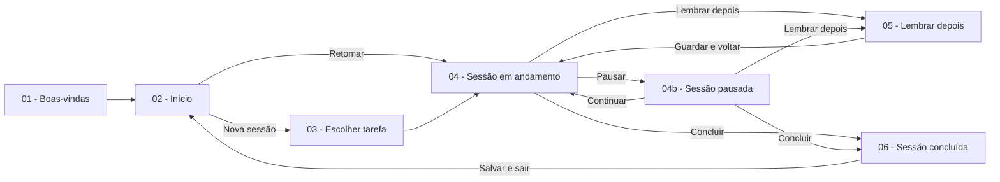

# Fluxo e Telas — Lume

## Fluxo principal

## Telas
| Frame | Objetivo | Elementos (de cima para baixo) | Ação principal | Navega para |
|---|---|---|---|---|
| 01 - Boas-vindas | Mostrar que o app é "sem pressão" | Ilustração do céu + mascote · título "Foque no seu ritmo" · frase "Sem contagem regressiva. Só você e o seu tempo." · botão | Começar | 02 |
| 02 - Início | Retomar ou começar rápido | Header/Saudação · Card/ContinuarDaqui (Onde parei + Próximo passo + botão **Retomar — primário**) · Botão/Grande "Nova sessão" (secundário) · lista "Hoje" (Card/Tarefa com tempo) | Retomar / Nova sessão | 04 / 03 |
| 03 - Escolher tarefa | Definir o objetivo da sessão | Barra/Topo (voltar) · título · rótulo "No que vai focar?" + Input (placeholder "Ex.: Estatística — cap. 4") · "Tarefas recentes" (Card/Tarefa com "última vez: X min") · botão | Começar | 04 |
| 04 - Sessão em andamento | Focar no próprio ritmo | Chip com o nome da tarefa · Cronômetro subindo (00:16:42) · referência discreta "última vez: 42 min" · mensagem de apoio · Pausar + Lembrar depois · botão Concluir | Concluir | 06 (ou 05 / 04b) |
| 04b - Sessão pausada | Pausar sem perder o lugar | Igual ao 04, com o cronômetro parado · "Pausado" no lugar da mensagem de apoio · Continuar + Lembrar depois · botão Concluir | Continuar | 04 (ou 05 / 06) |
| 05 - Lembrar depois | Guardar a tarefa paralela e voltar | Barra/Topo · título "O que você precisa lembrar?" · Input · lista de lembretes anotados · botão | Guardar e voltar | 04 |
| 06 - Sessão concluída | Ver a evolução e registrar onde parou | Mascote comemorando · título · Card/Métrica (tempo de hoje, última vez, lembretes) · mensagem de comparação gentil · rótulo "Onde parei?" + Input · rótulo "Próximo passo" + Input · botão | Salvar e sair | 02 |

## Interações do protótipo (para a F4)
> Na F4, Pausar/Continuar vira **interactive component** (Change to) dentro da tela 04; o frame 04b existe só no wireframe.
| De | Gatilho | Para | Transição |
|---|---|---|---|
| 01 | Toque em "Começar" | 02 | Dissolve 250 ms |
| 02 | Toque em "Nova sessão" | 03 | Slide da direita 250 ms |
| 02 | Toque em "Retomar" | 04 | Dissolve 300 ms |
| 03 | Toque em "← Voltar" | 02 | Slide da esquerda 250 ms |
| 03 | Toque em "Começar" | 04 | Dissolve 300 ms |
| 04 | Toque em "Pausar" | 04b | Dissolve 200 ms |
| 04b | Toque em "Continuar" | 04 | Dissolve 200 ms |
| 04 | Toque em "Lembrar depois" | 05 | Slide de baixo 250 ms |
| 04b | Toque em "Lembrar depois" | 05 | Slide de baixo 250 ms |
| 05 | Toque em "Guardar e voltar" | 04 | Slide para baixo 250 ms |
| 05 | Toque em "← Voltar à sessão" | 04 | Slide para baixo 250 ms |
| 04 | Toque em "Concluir" | 06 | Smart Animate 300 ms |
| 04b | Toque em "Concluir" | 06 | Smart Animate 300 ms |
| 06 | Toque em "Salvar e sair" | 02 | Dissolve 250 ms |
