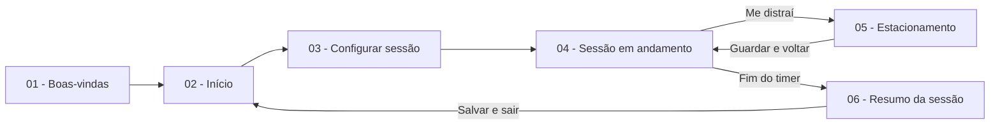

# Fluxo e Telas — Lume

## Fluxo principal

## Telas
| Frame | Objetivo | Elementos | Ação principal | Navega para |
|---|---|---|---|---|
| 01 - Boas-vindas | (F1) | | Começar | 02 |
| 02 - Início | | | Nova sessão | 03 |
| 03 - Configurar sessão | | | Iniciar foco | 04 |
| 04 - Sessão em andamento | | | Pausar / Me distraí | 05 / 06 |
| 05 - Estacionamento | | | Guardar e voltar | 04 |
| 06 - Resumo da sessão | | | Salvar e sair | 02 |
