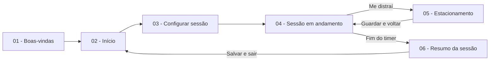

# Fluxo e Telas — Lume

## Fluxo principal

## Telas
| Frame | Objetivo | Elementos (de cima para baixo) | Ação principal | Navega para |
|---|---|---|---|---|
| 01 - Boas-vindas | Explicar o app em uma frase | Ilustração do céu + mascote · título · frase de valor · botão | Começar | 02 |
| 02 - Início | Começar rápido, com contexto | Header/Saudação · Card/ContinuarDaqui · Botão/Grande "Nova sessão" · lista "Hoje" (Card/Tarefa) | Nova sessão | 03 |
| 03 - Configurar sessão | Definir tarefa e tempo sem esforço | Barra/Topo (voltar) · título · Input "No que vai focar?" · Chip/Duração 15·25·45 · botão | Iniciar foco | 04 |
| 04 - Sessão em andamento | Manter a atenção | Chip com nome da tarefa · Timer · texto "restam X minutos" · mensagem de apoio · Pausar + Me distraí | Me distraí / fim do timer | 05 / 06 |
| 05 - Estacionamento | Tirar o pensamento da cabeça e voltar | Barra/Topo · título "O que passou pela cabeça?" · Input · lista de distrações anotadas · botão | Guardar e voltar | 04 |
| 06 - Resumo da sessão | Celebrar e registrar onde parou | Mascote comemorando · título · Card/Métrica (minutos, distrações) · Input "Onde você parou?" · botão | Salvar e sair | 02 |

## Interações do protótipo (para a F4)
| De | Gatilho | Para | Transição |
|---|---|---|---|
| 01 | Toque em "Começar" | 02 | Dissolve 250 ms |
| 02 | Toque em "Nova sessão" | 03 | Slide da direita 250 ms |
| 03 | Toque em "Iniciar foco" | 04 | Dissolve 300 ms |
| 04 | Toque em "Me distraí" | 05 | Slide de baixo 250 ms |
| 05 | Toque em "Guardar e voltar" | 04 | Slide para baixo 250 ms |
| 04 | Após delay (simula fim do timer) ou toque no timer | 06 | Smart Animate 300 ms |
| 06 | Toque em "Salvar e sair" | 02 | Dissolve 250 ms |
